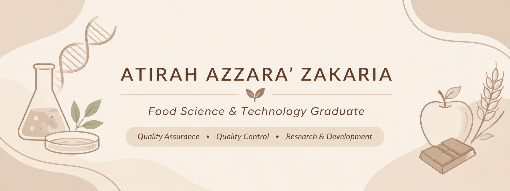
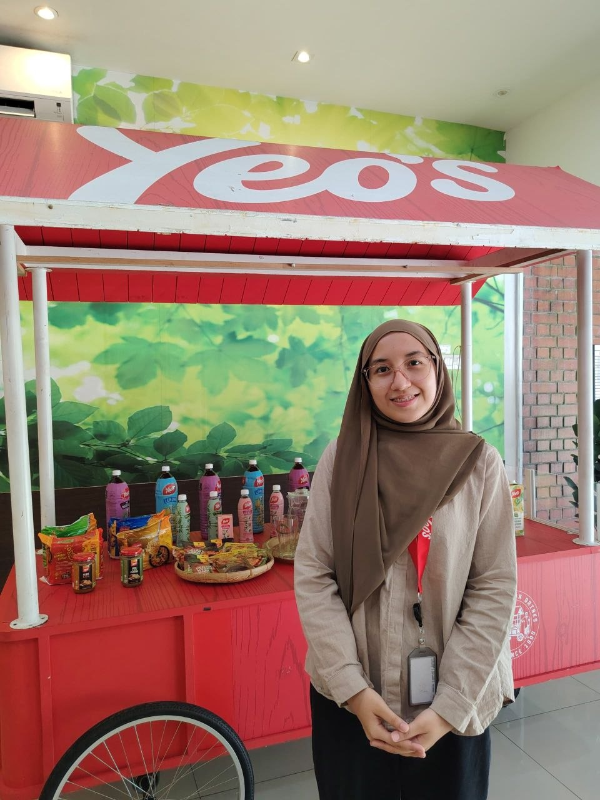

  

<h2 align="center">About Me</h2>

I am a fresh graduate with a background in Food Science and Technology, interested in quality assurance, quality control, and product development in the food and beverage industry.

I have practical experience in food laboratory testing, product evaluation, food safety, and regulatory compliance through my industrial training in the R&D department at Yeo's.

---

<h2 align="center">Skills & Expertise</h2>

  
  
  
  
  
  

<h3 align="center">Laboratory & Technical Skills</h3>

- **Food Analysis:** Proximate Analysis, Kjeldahl, Soxhlet and Rancimat
- **Instrumental Analysis:** Texture Profile Analyser, Viscometer and Rheometer
- **Microbiology:** General Microbiology, Media Preparation and Formulation
- **Molecular Techniques:** DNA Extraction and Gel Electrophoresis
- **Food Evaluation:** Physicochemical Analysis and Sensory Evaluation
- **Food Processing:** Solid, Semi-solid and Liquid Food Unit Operations

<h3 align="center">Digital Tools & Software</h3>

  
  
  
  
  
  
  
  
  

---

<h2 align="center">Certifications & Training</h2>

  
  
  

---

<h2 align="center">Experience</h2>

### R&D Intern – Yeo Hiap Seng (Malaysia) Berhad

  

- Conducted physicochemical and sensory evaluations.
- Performed product stability monitoring.
- Gained exposure to food regulatory compliance.
- Participated in product evaluation and laboratory activities.

---

<h2 align="center">Academic Projects</h2>

### 1. Physicochemical and Sensorial Properties of Cempedak (*Artocarpus integer*) Seeds in Chocolate Pudding

**Final Year Project | Bachelor of Food Science and Technology**

  

  <i>Chocolate pudding fortified with cempedak seed flour, showcasing food by-product utilisation and innovative product development.</i>

- Developed chocolate pudding formulations using cempedak seed flour as a partial substitute for cornstarch.
- Conducted physicochemical analyses, including moisture, ash, protein, fat, fibre and starch determination.
- Evaluated viscosity and colour properties of the formulated products.
- Conducted sensory evaluation to assess consumer acceptance.
- Identified the optimum formulation based on physicochemical and sensory results.

**Key Skills**

  
  
  
  
  
  

### 2. Butterfly Pea SereniTeh – Eye Health Beverage

**Research & Development Project | Food Innovation & Product Development (FIPD)**

  

  <i>Butterfly Pea SereniTeh – A botanical beverage concept developed for eye health-focused product innovation.</i>

- Developed a functional beverage concept focusing on eye health using butterfly pea flower as a key botanical ingredient.
- Researched antioxidant-rich ingredients, including vitamin E and anthocyanin sources, for potential eye health benefits.
- Explored botanical ingredient combinations to develop an innovative and appealing beverage.
- Conducted research and experimentation on suitable packaging options for an instant beverage product.

**Key Skills**

  
  
  
  
  
  
  

---

<h2 align="center">Connect With Me</h2>

  
  

  <i>Thank you for visiting my profile!</i> 🤎

